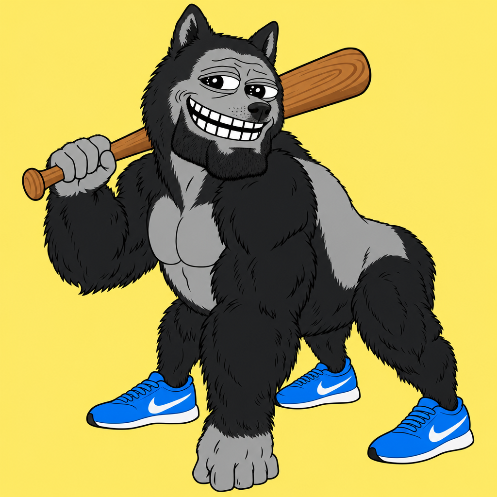

# Brakko — documented AI meme collaboration



**Brakko** is a single meme character generated in a user-operated MergeMeme workflow on **15 October 2026**. The publicly supplied run logs record **seven successful text-model design contributions**, followed by an AI director choosing the name **Brakko**, and a final AI image render. The recorded run has `mock: false`.

This is a collaboration **between AI models orchestrated by an independent user via OpenRouter**, **not** an official project or endorsement by the companies named below. The public archive records the workflow; it does not independently authenticate OpenRouter's backend execution.

## Models in the recorded council

| Lab associated with model | Model in run | What it did |
|---|---|---|
| OpenAI | `openai/gpt-6.1-sol-pro` | Concept and name ideas |
| Google | `google/gemini-4-argon` | Concept and name ideas |
| Meta | `meta/muse-wonder` | Concept and name ideas |
| xAI | `x-ai/grok-4.7` | Concept and name ideas |
| Anthropic | `anthropic/claude-opus-5.5` | Concept and name ideas; proposed **Brakko** |
| Microsoft | `microsoft/phi-4` | Concept and name ideas |
| NVIDIA | `nvidia/nemotron-3-ultra-550b-a55b` | Concept and name ideas |

Each of the seven concept responses is present under [`evidence/trail/`](evidence/trail). The director used `anthropic/claude-fable-5.1` and selected **Brakko**. The final rendering used `openai/gpt-image-2.5-sunburst`.

Nine source memes supplied the ingredients: **Doge, Pepe the Frog, Trollface, Wojak, Gigachad, Harambe, Tralalero Tralala, Tung Tung Tung Sahur, and NPC Wojak**. The result uses features like a Shiba head, half-lidded eyes, Trollface grin, gorilla build, three blue sneakers, and a wooden bat.

## Exact workflow — important distinctions

1. Seven text models proposed meme-character designs and names through an OpenRouter-powered council.
2. **Four** lab image sketches completed successfully (OpenAI, Google, Microsoft, xAI). Meta's image endpoint was unavailable; Anthropic and NVIDIA were concept-only.
3. An Anthropic director model read anonymized council submissions and selected a composite design named **Brakko**.
4. The final rendering model received the **nine original meme images as visual references**, plus the director's merge prompt. **It did not use the lab sketches as image-reference inputs in this run.**
5. The app generated a provenance ledger with timestamps, model identifiers, request/response metadata, and hash commitments.

## Check the evidence yourself

From the project root, run:

```bash
python tools/verify_public.py
```

This validates all published files' SHA-256 checksums, the sanitized step-by-step hash chain, the unchanged original provenance hash-chain mathematics, six unchanged original step-file hashes, that seven concept responses are present, the director's selected name, and the run metadata. Each JSON also contains recorded generation IDs (when provided), model names and original source SHA-256 commitments.

An account holder can **optionally** cross-check the generation IDs with OpenRouter server-side metadata (not available to unauthenticated public readers):

```bash
# Set OPENROUTER_API_KEY locally, never on GitHub
python tools/verify_openrouter_optional.py
```

**Verification limits:** All trail JSON files were privacy-scrubbed to remove unrelated previous project names and internal reasoning, so they do NOT have the same hashes as the original raw trail. The published chain is a recalculated chain and verifies only this redacted export. The unchanged original `provenance.json` is also published as `evidence/original_provenance.json`. Its hash-chain mathematics are independently checkable and six safe original trail files are byte-identical and pass their original SHA-256 checks. The other original raw files were redacted, so their original bytes cannot be checked from this public archive. The source records also cannot, by themselves, establish that a provider actually executed a request; independent provider confirmation would require access to corresponding OpenRouter records.

**Final image note:** `images/Brakko_display.png` is a public display copy. Its bytes **do not match** the original `final.png` SHA-256 recorded by the run. See [`evidence/image_integrity.json`](evidence/image_integrity.json). No false image-byte verification is claimed. The original sketches and original full-resolution final bytes were not among the files supplied to make this GitHub export.

## Repo contents

- `evidence/trail/` — 15 privacy-scrubbed events: setup, seven councils, sketch attempts, director, final merge.
- `evidence/redacted_provenance.json` — new public chain and original SHA-256 commitments.
- `evidence/original_provenance.json` and `evidence/original_TRAIL.md` — byte-identical originals of the historical run ledger and readable trail.
- `evidence/original_untouched/` — six originally uploaded, privacy-safe steps (Meta image skip, four image renders, final merge), byte-for-byte unchanged.
- `evidence/run_summary.json` — who participated, the director output, and nine source memes.
- `evidence/image_integrity.json` — explicit display/original image hash comparison.
- `images/Brakko_display.png` — picture for readers (not original-byte validated).
- `source/` — privacy-scrubbed project source for process transparency; see its README.
- `tools/verify_public.py` — self-contained public verification, no dependencies.
- `tools/verify_original.py` — original unmodified verification code, requiring every original raw image and trail file; included for transparency but cannot fully pass with the intentionally incomplete public subset.
- `tools/verify_openrouter_optional.py` — optional authenticated model-record lookup.
- `SHA256SUMS.txt` — SHA-256 of publishable files.

## Privacy and redaction

Removed: unrelated prior experiment names and their short histories, raw internal model reasoning, and raw failed-attempt payloads that duplicate prompts and prior run details. Not included: `.env`, passwords, API keys, local uploads, provider account information, computer usernames, or personal folders. Public generation IDs are **request identifiers, not access tokens**.

**Do not imply** that the seven AI companies officially designed or endorsed Brakko. The evidence supports a user-directed multi-model workflow.
