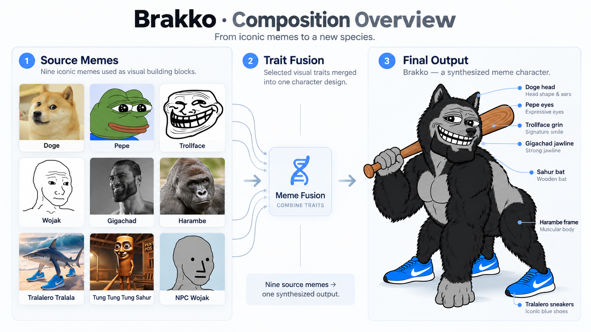

# Brakko

**Seven AI model families. Nine source memes. One new character.**



**Brakko** is a new meme character generated on **October 15, 2026**, using *MergeMeme*, an independent multi-model workflow operated through [OpenRouter](https://openrouter.ai/). Seven text models from different AI model families contributed concepts and name ideas. An AI director selected the name **Brakko** and assembled the final design, which was rendered by an AI image model.

> **Project status:** An independent, user-orchestrated experiment. The participating models are associated with OpenAI, Google, Meta, xAI, Anthropic, Microsoft, and NVIDIA. **Those companies did not officially collaborate on or endorse Brakko.**

## Run overview

| Property | Recorded value |
| --- | --- |
| Date | October 15, 2026 |
| Run ID | `20261015-115328-0f0104` |
| Text-model contributions | 7 successful council responses |
| Source characters | 9 memes |
| Completed model sketches | 4 (OpenAI, Google, Microsoft, xAI) |
| Director | `anthropic/claude-fable-5.1` |
| Final image model | `openai/gpt-image-2.5-sunburst` |
| Run mode | `mock: false` (as recorded in logs) |
| Public verification | `python tools/verify_public.py` |

## How it was created

**1. Source selection.** The workflow started with nine existing meme characters: Doge, Pepe the Frog, Trollface, Wojak, Gigachad, Harambe, Tralalero Tralala, Tung Tung Tung Sahur, and NPC Wojak.

**2. AI council.** Each of seven text models proposed a design, recognizable traits, a new name, and a sketch prompt.

**3. Concept sketches.** Four image models produced sketches. Meta's image endpoint was unavailable; Anthropic and NVIDIA participated through text concepts only.

**4. Director selection.** An AI director evaluated anonymized council submissions, chose the name **Brakko** (first proposed by the Anthropic council model), and wrote the final character specification.

**5. Final image.** `openai/gpt-image-2.5-sunburst` rendered Brakko from the director's prompt **with the nine original meme images as references**. The completed council sketches were *not* used as image-reference inputs for this final render.

The character combines details such as Doge's head, Pepe's heavy-lidded eyes, Trollface's grin, a Gigachad-style jaw, Harambe's build, Tralalero's blue sneakers, and Tung Tung Tung Sahur's bat. The banner above is an **illustrative composition diagram**, not an original workflow output or cryptographic proof.

## Models used

| Model family | Council text model |
| --- | --- |
| OpenAI | `openai/gpt-6.1-sol-pro` |
| Google | `google/gemini-4-argon` |
| Meta | `meta/muse-wonder` |
| xAI | `x-ai/grok-4.7` |
| Anthropic | `anthropic/claude-opus-5.5` |
| Microsoft | `microsoft/phi-4` |
| NVIDIA | `nvidia/nemotron-3-ultra-550b-a55b` |

The recorded design proposals and name suggestions are available in [`evidence/trail/`](evidence/trail/). The director's decision and final image request are documented in the same trail.

## Verify the evidence

Clone or download this repository, then run from the repository root:

```bash
python tools/verify_public.py
```

The public verifier checks the SHA-256 hashes of the published evidence, the integrity of the **redacted export's** hash chain, original provenance-chain calculations, six byte-identical original step files, and the recorded council/director results. No API key is required for this check.

### Key evidence files

| File | Purpose |
| --- | --- |
| [`evidence/run_summary.json`](evidence/run_summary.json) | Overview of the run, models, source memes and result |
| [`evidence/trail/`](evidence/trail/) | 15 privacy-redacted workflow steps |
| [`evidence/redacted_provenance.json`](evidence/redacted_provenance.json) | Recalculated hashes and chain for the public export |
| [`evidence/original_provenance.json`](evidence/original_provenance.json) | Unmodified original provenance ledger |
| [`evidence/original_untouched/`](evidence/original_untouched/) | Six original step records retained byte-for-byte |
| [`evidence/image_integrity.json`](evidence/image_integrity.json) | Image hash comparison and limitations |
| [`PRIVACY_AUDIT.md`](PRIVACY_AUDIT.md) | Description of the privacy redactions |

An authorized OpenRouter account holder may optionally compare recorded generation IDs with provider-side metadata:

```bash
# Configure OPENROUTER_API_KEY locally. Never commit it.
python tools/verify_openrouter_optional.py
```

### What the evidence does—and does not—prove

- The published files document seven text-model design responses, director selection, and a final image-generation request. The recorded run states `mock: false`.
- The public trail is **privacy-redacted**. Its checksums verify the published export; most redacted step files cannot be checked byte-for-byte against the original private raw files. Six unmodified steps are published separately.
- The display image at [`images/Brakko_display.png`](images/Brakko_display.png) **does not match the original final render's recorded SHA-256**. The original final image bytes are not included. The header diagram is a later illustration.
- Local hash verification shows that records are internally consistent. It **cannot independently authenticate** OpenRouter's server-side execution without provider records.

## Repository structure

```text
Brakko/
├── README.md
├── 2346f880-c026-477c-ac9c-35cfdc1fbd5e.png   # README illustration
├── PRIVACY_AUDIT.md
├── SHA256SUMS.txt
├── evidence/                                     # run records and integrity files
├── images/                                       # public display image
├── source/                                       # privacy-scrubbed project source
└── tools/                                        # verification scripts
```

---

*Brakko is an independent experiment in multi-model character design, not an official project of the AI companies referenced above.*
